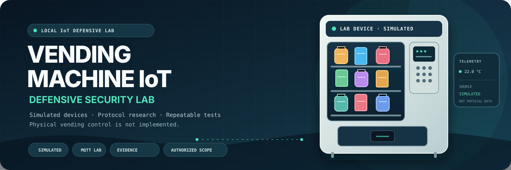
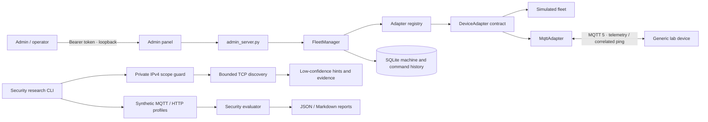
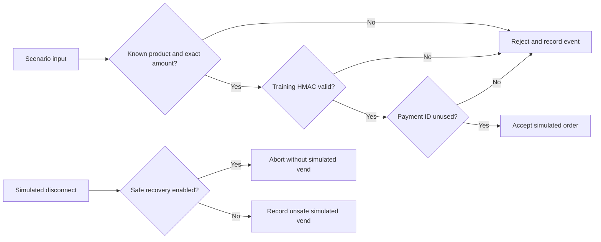

<p align="center">
  
</p>

# Vending Machine IoT — Defensive Security Lab

### Lab IoT Defensive: simulated vending machine

Machine Vending Lab is a local, security-focused IoT project for studying defensive controls in vending-machine and generic IoT simulations. It combines deterministic purchase-validation scenarios, a multi-device administration console, a generic MQTT adapter and an experimental security-research toolkit.

The project is designed for learning, testing and research in controlled environments. Simulated transactions and products are fictional. The repository does **not** provide a driver for a commercial vending machine, a commercial payment terminal or a physical dispenser.

> **Current status:** the MQTT adapter has been exercised with Mosquitto and a generic lab device. This confirms that adapter’s documented lab schema only; it does not establish compatibility with vending hardware or any manufacturer.

## Scope and required boundaries

- The purchase-validation scenarios in `scenarios/lab.py` are in-memory simulations. They do not send network traffic or connect to hardware.
- MQTT E2E tests use a local broker and a generic simulated IoT peer. They only exercise telemetry and `device.ping`.
- The security-research CLI can make bounded TCP connection attempts, but only against an explicitly supplied loopback/RFC1918 scope. Run it only on systems and networks you are authorized to assess.
- Security profiles and their findings are synthetic fixtures, not results from a real device assessment.
- The repository contains simulated replay and message-tampering cases for testing defensive logic. It does not include malware, persistence, reverse shells, authentication bypasses or third-party exploitation tooling.
- There are no commercial payment integrations, real card data or live vending transactions.

See [docs/ethical-scope.md](docs/ethical-scope.md) and [docs/security-research.md](docs/security-research.md) for the detailed limits.

## Project structure

```text
app/
├── admin_server.py             Loopback-only fleet/admin HTTP API
├── admin.html                  Local administration panel
├── devices/
│   ├── device_adapter.py       Shared adapter contract
│   ├── registry.py             Adapter registration and selection
│   ├── simulator.py            Simulated fleet profiles
│   ├── mqtt_adapter.py         Generic MQTT 5 adapter
│   └── mqtt_lab_device.py      Generic simulated MQTT peer
├── services/fleet_manager.py   Fleet, capabilities, commands and SQLite history
├── security_research/          Bounded discovery, fixture evaluator and reports
├── security/                   Security utilities (some legacy files are empty)
├── audit/                      Audit modules (some legacy files are empty)
└── storage/                    Storage modules (some legacy files are empty)
scenarios/                      In-memory purchase-validation exercises
tests/                          Unit, API, adapter and MQTT E2E tests
docs/                           Architecture, security, protocol and hardware guides
reports/                        Example assessment outputs
scripts/                        Local helper scripts
```

### Architecture

The administration API delegates machine operations to `FleetManager`. The fleet manager selects an adapter and uses its declared capabilities; simulators, MQTT peers and future manufacturer drivers remain behind the same adapter boundary. The security-research flow is separate: discovery records limited TCP observations, while the current MQTT/HTTP evaluator processes synthetic profiles.



### Simulated purchase-validation flow

The project does not currently implement the `IDLE → PAYMENT_PENDING → …` application state machine described by some legacy design files. The active `scenarios/lab.py` model applies these checks to a fictional order:



This is a small logic model, not a physical controller or an end-to-end commercial payment flow.

## Defensive controls represented

- Exact product and amount validation in the in-memory scenario model.
- HMAC-SHA256 message signing with a **fixed training-only key** in that model. It is not configurable through `HMAC_SECRET` and is not suitable for production.
- Single-use payment-ID checks held in the scenario’s in-memory set; this is not a persistent, expiring nonce service.
- Rejection paths for replayed, modified, unknown-product and incorrect-amount scenario inputs. There is no transaction-sequence state machine in the active scenario model.
- Safe-abort behavior in the simulated disconnect case when that control is enabled.
- Fleet command IDs and duplicate-request handling in the administration service; persisted command history is separate from the in-memory scenario model.
- MQTT schema validation and correlation of `device.ping` responses. Broker PUBACK alone is not treated as device execution.
- Authentication, role checks and strict JSON validation in the loopback administration API.

These controls are educational implementations. They do not provide a production vending-machine safety or payment certification.

## Configuration and local execution

Requires Python 3.10 or later. The core application has no third-party runtime dependencies; Paho MQTT is an optional extra.

```sh
python3 -m venv .venv
source .venv/bin/activate
python -m pip install -e .
```

To run the in-memory scenario suite:

```sh
python -m scenarios.run_all
python -m scenarios.run_all --scenario replay
python -m scenarios.run_all --scenario tamper --json
```

Available scenario names: `normal`, `replay`, `tamper`, `invalid-order`, `disconnect` and `chain`. You can compare the model configurations with `--profile hardened` and `--profile vulnerable`. “Vulnerable” means controls are disabled in the local model; it does not run attacks against a device.

### Administration console

The active local console is `app.admin_server`, not `uvicorn app.main:app`. The legacy `app/main.py` and `app/api/routes_*.py` files are empty, so the older FastAPI route layout is not currently served.

```sh
export VENDING_ADMIN_TOKEN="$(openssl rand -hex 32)"
python -m app.admin_server
```

Open `http://127.0.0.1:8080`. The server binds to loopback only. The admin token must contain at least 32 characters. Optional distinct roles use `VENDING_OPERATOR_TOKEN` and `VENDING_VIEWER_TOKEN`; `VENDING_PORT` and `VENDING_DB` configure the port and SQLite path. See [.env.example](.env.example) for names and safe empty examples. Do not commit real tokens or passwords.

Implemented administration routes include:

| Method | Route | Purpose |
|---|---|---|
| GET | `/api/session` | Current authenticated role |
| GET | `/api/adapters`, `/api/machines`, `/api/commands` | Adapter, fleet and command listings |
| GET | `/api/audit` | Access audit, admin only |
| GET | `/api/machines/{id}` | Machine details |
| GET | `/api/machines/{id}/capabilities` | Declared capabilities |
| GET | `/api/machines/{id}/status`, `/inventory`, `/diagnostics`, `/telemetry`, `/alarms`, `/sales`, `/payment`, `/commands` | Machine resources and command history |
| POST | `/api/machines` | Register a machine using an existing adapter |
| POST | `/api/machines/{id}/commands` | Request a supported capability |
| GET | `/api/status`, `/api/inventory`, `/api/events` | Local legacy/demo resources |

The server does not implement `/health` or `/transactions` routes. The admin and fleet API models are not the same as the empty legacy API modules.

## MQTT lab

The generic MQTT adapter supports versioned telemetry and `device.ping` for peers that implement the documented schema. MQTT transport support does **not** mean a vending controller is compatible.

Install Paho and Mosquitto on macOS:

```sh
source .venv/bin/activate
python -m pip install -e '.[mqtt]'
brew install mosquitto
brew services start mosquitto
nc -vz 127.0.0.1 1883
```

Run the generic IoT peer in another terminal:

```sh
source .venv/bin/activate
python -m app.devices.mqtt_lab_device \
  --broker 127.0.0.1 --port 1883 --device-id lab-device-01
```

Register `lab-device-01` from the panel with adapter `protocol.mqtt.generic.v1`. The peer publishes simulated telemetry and responds only to the generic ping command; it is not a vending-machine simulator.

Run the broker-backed integration tests:

```sh
VENDING_MQTT_TEST_BROKER=127.0.0.1 \
  python -m unittest tests.test_mqtt_integration -v
```

The E2E test checks connection, telemetry, correlated application confirmation, duplicate requests, timeout without a device, process restart/recovery and invalid telemetry. It does not execute sales or dispensing. See [docs/mqtt-protocol.md](docs/mqtt-protocol.md).

## Security research toolkit

Run a deterministic fixture assessment and export a report:

```sh
python -m app.security_research.cli lab \
  --profile iot-mqtt-insecure \
  --json reports/iot-mqtt-insecure.json \
  --markdown reports/iot-mqtt-insecure.md
```

Available fixtures: `iot-mqtt-hardened`, `iot-mqtt-insecure`, `vending-api-hardened-example`, `vending-api-insecure` and `generic-mdb-gateway-unknown`. Findings include synthetic evidence, impact, false-positive notes and mitigations. They do not establish the security posture of a real device.

The optional TCP discovery command requires a deliberately selected private/loopback scope:

```sh
python -m app.security_research.cli discover \
  --authorized-scope 127.0.0.1/32 \
  --ports 1883,8080
```

It is limited to RFC1918/loopback IPv4, a maximum of 64 addresses and an allowlist of common management ports. It performs TCP connect checks only. Port-number hints have low confidence and are not protocol handshakes or device identification. Use it only on a lab segment you are explicitly authorized to assess. Full constraints: [docs/security-research.md](docs/security-research.md).

## Tests and repeatable experiments

```sh
python -m unittest discover -s tests -v
python -m unittest tests.test_security_research -v
```

The MQTT E2E class is skipped if Paho or a reachable local broker is unavailable. With the broker running, the full discovery command also includes those broker-backed tests. Tests use temporary databases and the generic lab peer; none requires physical vending hardware.

## Docker and Makefile status

`Dockerfile`, `docker-compose.yml`, `Makefile` and `requirements.txt` are currently empty files. Docker deployment, Compose startup and the proposed `make install/test/run` commands are **not implemented**. Use the Python and Mosquitto commands in this README until those files have working contents. The project configuration and optional dependency are defined in `pyproject.toml`.

## Hardware and future manufacturer adapters

`app/devices/device_adapter.py` defines the shared contract, and `app/devices/registry.py` registers the simulator and generic MQTT adapter. There is no ESP32/Raspberry Pi driver, vendor API adapter, serial/USB/Modbus driver, MDB/ICP bus implementation, commercial reader integration or physical vending control in this repository.

A manufacturer adapter needs an exact controller model and firmware, official protocol documentation, an authorized test unit or sandbox, legitimate credentials, safe electrical interfaces and tests that verify each declared capability. Do not infer vending compatibility from MQTT, HTTP, Modbus or MDB/ICP alone. See [docs/hardware-integration.md](docs/hardware-integration.md) and [docs/adapter-development.md](docs/adapter-development.md).

## Further reading

- [Threat model](docs/threat-model.md) · [Security controls](docs/security-controls.md) · [Ethical scope](docs/ethical-scope.md)
- [State-machine design notes](docs/state-machine.md) · [Experiments](docs/experiments.md) · [Example results](docs/example-results.md)
- [Security research](docs/security-research.md) · [Architecture](docs/architecture.md) · [MQTT schema](docs/mqtt-protocol.md)
- [Hardware integration](docs/hardware-integration.md) · [Adapter development](docs/adapter-development.md) · [Sample reports](reports/sample-results.md)

If this project is useful for your research, consider giving it a star ⭐ Thanks!
